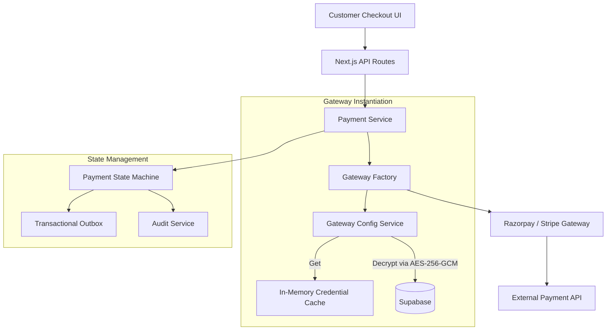

# Menuara Payment Subsystem Architecture

## Overview
The Menuara payment subsystem is a production-grade, multi-tenant payment platform designed for B2B2C SaaS restaurant operations. It provides strict guarantees around correctness, idempotency, security, and auditability.

**Architecture Status:** Frozen (V2.5 Enterprise Edition)
> **Engineering Rule:** No further architectural refactoring of the payment core without a documented RFC. Future work must be additive (e.g., adding Stripe, building Refund modules on top).

---

## 1. Core Principles
- **Multi-Tenant Gateway:** Funds are routed directly to the restaurant's own payment gateway account (e.g., Razorpay) without touching Menuara's master accounts.
- **Provider-Agnostic Abstraction:** The core business logic interacts with a `PaymentGateway` interface, completely unaware of the underlying provider (Razorpay, Stripe, etc.).
- **Optimistic Concurrency:** Payments utilize an `UPDATE ... WHERE version = expected_version` pattern to prevent double-charging or split-brain states.
- **Database as the Source of Time:** Expiration and timeouts rely strictly on PostgreSQL's `NOW()`, eliminating risks from Node.js clock drift.

---

## 2. Architecture Diagram & Request Flow

---

## 3. Database Schema Highlights

- **`payments`**: The core aggregate root. Stores immutable `bill_snapshot`, cryptographic `bill_hash`, and optimistic concurrency `version`.
- **`restaurant_payment_integrations`**: Stores encrypted credentials (`encrypted_secret`, `previous_encrypted_secret`).
- **`payment_outbox`**: Implements the Transactional Outbox pattern for publishing events reliably.
- **`payment_webhook_logs`**: Ensures webhook idempotency via `UNIQUE(provider, gateway_event_id)` at the database level.
- **`integration_events`**: Audit trail for secret rotations, integrations, and connection tests.

---

## 4. Security Model
- **AES-256-GCM:** All API keys and webhook secrets are encrypted at the application layer *before* being written to Supabase. Database administrators cannot read the raw secrets, and database backups are secure by default.
- **Secret Rotation Grace Period:** When a restaurant rotates their API keys, the old secret is stored as `previous_encrypted_secret` with a 24-hour grace period to ensure in-flight webhooks are not dropped due to signature mismatches.
- **Hard Configuration Failures:** If an active gateway is missing, the system strictly throws a `ConfigurationError` (`ALLOW_ENV_FALLBACK=false` in production). It never silently falls back to a sandbox/master account.

---

## 5. State Machine & Event Catalog

### Valid States
`created` ➔ `pending` ➔ (`captured` | `failed` | `expired` | `cancelled`)

### Event Catalog (Transactional Outbox)
Events are guaranteed to be published asynchronously after the payment transaction commits.
- `PaymentCreated`: Customer initiated the checkout flow.
- `PaymentPending`: Payment intent successfully registered with the gateway.
- `PaymentCaptured`: Webhook or polling confirmed the payment is complete.
- `PaymentFailed`: Gateway rejected the payment.
- `PaymentExpired`: The payment session timed out.

---

## 6. Operational Runbook & Recovery Procedures

### 1. Webhook Failures / Dead Letter Queue (DLQ)
If an outbox event fails to publish repeatedly, it enters a `DEAD` state in the DLQ.
- **Action:** Run the manual DLQ replay script: `npx tsx scripts/replay-dlq.ts`.
- **Note:** Processing is strictly idempotent.

### 2. Missing Keys or Decryption Errors
If a restaurant's payments immediately fail with a Configuration Error:
- Verify the restaurant has configured Razorpay in `/admin/integrations`.
- Ensure the server `APP_ENCRYPTION_KEY` matches the key used during creation.

### 3. Reconciling "Stuck" Pending Payments
If a customer claims they paid, but the system shows `pending`:
- The background cron job (`process-pending-payments`) should automatically fetch the status from the gateway and resolve it within 15 minutes.
- If manual intervention is required, staff can trigger a status sync via the Admin Dashboard.
